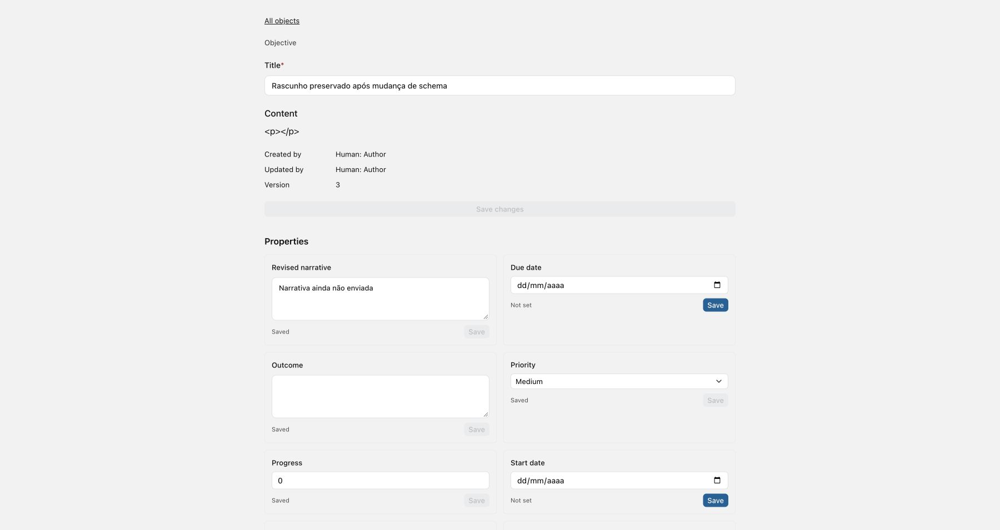

# RADAR Core U1 — Entrega da fase 2

**Data:** 06/10/2026, America/Bahia. **Status:** fase 2 implementada e validada em ambiente isolado. **Escopo concluído:** C07, C11, C12 e parte estrutural de C17. Permanecem **10 U1 e 2 U2**; capabilities, criação e lifecycle seguem na fase 3. [Plano](CORE_U1_IMPLEMENTATION_PLAN.md), [decisões](CORE_U1_PHASE_02_ADR.md), [evidências](../../output/core-u1-phase-02-20261006/README.md).

## Resultado

| Achado | Entrega                                                                                                                 | Resultado                       |
| ------ | ----------------------------------------------------------------------------------------------------------------------- | ------------------------------- |
| C07    | Instalação explícita, base/IDs geridos, preview/diff de três vias, upgrade auditado, baseline legado                    | Corrigido                       |
| C11    | Política operacional comum para tipos, Objects, definições/valores e relações/endpoints; histórico explícito            | Corrigido                       |
| C12    | Revisão de metadata, snapshots coerentes, precondições, cache monotônico, revisão dos formulários e autoridade separada | Corrigido                       |
| C17    | Registro estrutural de kinds/config/relações, validação antes de persistir e equivalência backend/cliente               | Parcial; capabilities na fase 3 |

`WorkspaceSchemaState` guarda revisão efetiva, origem, versão/hash e base materializada com IDs. `SchemaUpgrade` registra instalação/upgrade. O flush de comandos auditados incrementa a revisão uma vez por transação de metadata; `Object.version` continua exclusivamente a revisão dos fatos. Locks e rollback usam a coordenação conservadora por Workspace existente.

GETs deixaram de semear schema. Workspaces vazios anunciam `uninitialized`; provisioning administrativo é explícito. Initializers Python permanecem fachadas auditadas, com autoridade administrativa. O upgrade preserva IDs, alterações locais e retiradas intencionais; conflitos de ownership/campos e incompatibilidades factuais são apresentados, sem sobrescrever customizações nem migrar fatos automaticamente.

[active.py](../../apps/api/plane/radar/active.py) aplica a política de recursos atuais a lista, detalhe, snapshots, Today, Risk Review e runtime. Valores precisam pertencer ao tipo do Object; arestas precisam ter endpoints operacionais. Provenance consulta `all_objects` explicitamente, com autorização, conservando histórico de recursos retirados.

O catálogo agregado é lido sob lock e retorna `schema_revision`/`authority_revision`. Catálogos legados em arrays conservam o wire format, com revisão em cabeçalho; o CORS permite a precondição e expõe a revisão da resposta. Propriedades, relações, Today, contexto e capabilities anunciam a revisão. Aprovações incorporam a revisão ao fingerprint e propostas antigas tornam-se obsoletas.

O cliente rejeita respostas antigas e revisões incompatíveis, preserva drafts durante atualização e pede revisão explícita antes de novas escritas. Intenções incertas mantêm revisão/versões/chave originais. O servidor revalida schema e autoridade. Confirmed replay ocorre antes de recusar a revisão antiga; intenções v1 já confirmadas sem o novo campo continuam replayable. Membership/role e grants invalidam autoridade separadamente de metadata.

O registro estrutural contém 11 kinds, config schemas e descritores de relações. Defaults inválidos, choices/terminal, bounds, domains/pairs e cardinalidade inválidos são rejeitados antes de persistir. Kind changes, required/defaults e cardinalidade também passam por checks factuais. `pnpm check:radar-contracts`, integrado ao `pnpm check`, verifica 11 kinds, 5 chaves de config e 3 cardinalidades com o cliente. Aliases futuros e referências do pacote fora do slice estão documentados; nenhum ganha execução implícita.

## Migration e compatibilidade

A nova migration é [0012_workspace_schema](../../apps/api/plane/radar/migrations/0012_workspace_schema.py), após `0011_objecttype_rules`. Ela congela a materialização Core 3.2.0 e registra workspaces com metadata como `legacy`, revisão 1 e versão/hash desconhecidos. Diferenças/ausências/colisões locais são registradas; workspace vazio continua sem instalação. Mesmo um legado que coincide com o pacote não recebe uma versão presumida.

O teste com models históricos cobriu workspace vazio, pacote coincidente, customizado e divergente/inativo. IDs e fatos foram preservados, inclusive Object na versão 7. Ida 0011 → 0012, volta e reaplicação passaram. [Resultado](../../apps/api/output/core-u1-phase-02-migration.json).

Há mudança deliberada no provisioning: membros comuns/guests não instalam metadata. Testes antigos de bootstrap por GET ou membro foram adaptados para instalação/baseline administrativo explícito, conservando as assertions de escrita genérica e isolamento.

Commands genéricos de sessão exigem revisão de schema; callers Python confiáveis e runtime v1 podem omiti-la durante compatibilidade, sempre sujeitos à validação atual/fingerprint. Uploads de colaboração usam autoridade e revisão de fatos. Não houve aplicação de migration ou publicação no stack Plane em uso; ativação exige disponibilizar o app RADAR, aplicar a cadeia e provisionar/upgrade o schema de cada workspace conscientemente.

## Validação

| Verificação                    | Resultado                                                                                    | Evidência                                               |
| ------------------------------ | -------------------------------------------------------------------------------------------- | ------------------------------------------------------- |
| Baseline RADAR                 | 319 aprovados, 4 opt-in ignorados                                                            | `backend-baseline.log`                                  |
| Regressão RADAR final          | **356 aprovados, 4 opt-in ignorados**; 37 casos novos                                        | `backend-final.log`, JUnit `core-u1-phase-02-final.xml` |
| Transporte após ajuste de CORS | **5 aprovados**; reexecução, não soma à contagem                                             | `backend-transport.log`, JUnit de transporte            |
| Frontend                       | **114 aprovados em 16 arquivos**; 8 casos novos                                              | `frontend-final.log`                                    |
| Workspace                      | **56/56 tarefas**, incluindo lint/format/types e parity do registro                          | `workspace-check-final.log`                             |
| Python                         | Ruff e formatação aprovados                                                                  | `backend-style-final.log`, `backend-format.log`         |
| Migration                      | Baseline/IDs/fatos e ida/volta/reaplicação aprovados                                         | `migration.log` e JSON de resultado                     |
| Navegador dirigido             | Schema 1 → 2, rascunhos preservados, revisão explícita, duas escritas e reload com Object v3 | captura e prova do ledger/PostgreSQL                    |

As contagens são da suíte atual, sem somar baselines ou reexecuções. O `pnpm check` conserva avisos preexistentes; lint dos arquivos alterados passou com `--deny-warnings`. Não foram reexecutados os opt-ins de provider/CoS real nem toda a suíte Plane fora de RADAR.

## Fluxo verificado

**História:** um usuário mantém rascunhos de título/propriedade abertos enquanto um admin altera metadata; o catálogo atualizado exige revisão e o envio preserva as precondições até a confirmação e renderização dos fatos persistidos.

| Fronteira        | Evidência                                                                                                                         |
| ---------------- | --------------------------------------------------------------------------------------------------------------------------------- |
| UI               | ObjectPage, componentes, RootStore, service e provider reais; título e propriedade permaneceram no formulário após metadata mudar |
| Cliente → API    | PATCH de Object e PUT de propriedade com sessão real e `expected_schema_revision=2`; requests 200 nos logs                        |
| API → banco      | Comandos e provenance reais no PostgreSQL descartável; ledger registra expected_versions 1 e 2, results 2 e 3                     |
| Banco → resposta | Object v3, schema revision 2 e valor da propriedade conferidos pela prova independente de banco                                   |
| Resposta → UI    | Reload exibiu título/propriedade persistidos, autoria humana e versão 3; console sem erros durante o fluxo                        |

A fixture substitui shell/roteamento de preview, editor narrativo e picker de membros; autenticação/membership, API, commands, guards, ledger e banco são reais. Isso é validação dirigida da fase 2, sem alegar homologação do shell completo ou provider real. O CLI de browser não iniciou o Chrome; CUA conectado permitiu concluir o fluxo.

Após a validação principal, Docker/controle de aplicativos ficaram temporariamente indisponíveis. Docker voltou a responder e os testes de transporte rodaram no stack isolado. Essa ocorrência não é resultado de deploy nem de alteração do stack Plane.

## Limites e próxima fase

A revisão de schema não representa capacidades detalhadas por campo, transições ou efeitos compostos. O registry de capabilities/planners, criação e lifecycle continua na fase 3; por isso C17 permanece parcial. UI de builder e execução de migrações factuais incompatíveis não foram ativadas. As intenções continuam em memória, sem persistência após reload.

A coordenação por Workspace é conservadora e serializa upgrades com fatos. Polling/foco descobre mudanças na UI, e a precondição do servidor cobre a corrida antes dessa descoberta. O protocolo mantém contratos v1 de replay; novos callers devem enviar revisão explicitamente. Alterações anteriores staged/unstaged/untracked foram preservadas, sem commit ou deploy.
