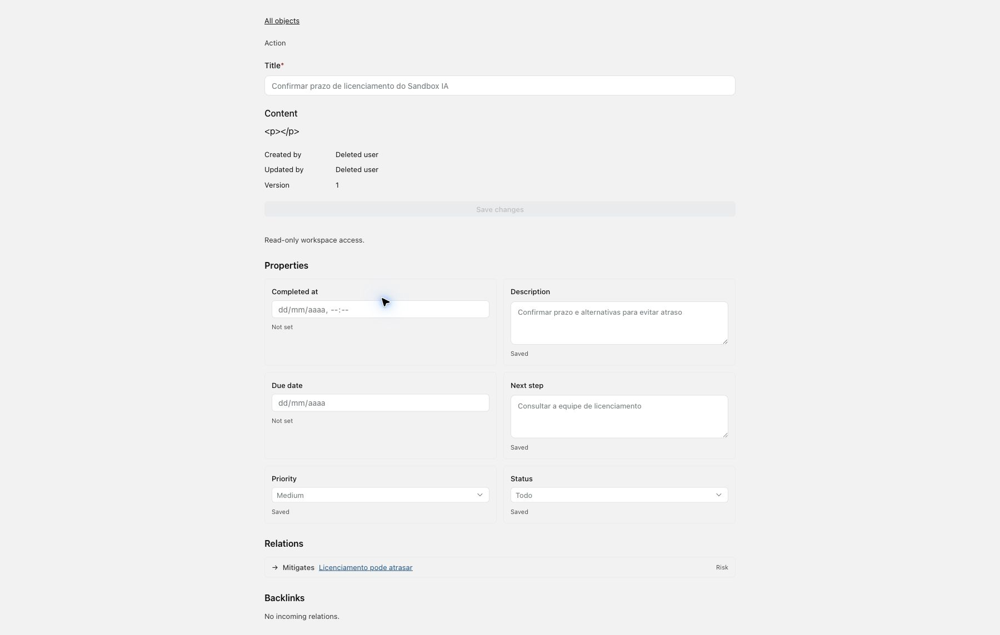

# Evidências — Risk Review 1.5

Implementado e validado localmente em 05/10/2026. Sem commit/merge/deploy. [Contrato e limites](../../docs/radar/RISK_REVIEW.md).

## Resultado

- Backend RADAR: **229 passaram**, incluindo **27** casos Risk Review; migration drift sem alterações. [Log](backend-final-tests.log).
- CoS: **1.182 passaram**, 11 opt-in desativados, zero falhas/erros; [JUnit](cos-final.xml) e [log](cos-final.log).
- Frontend: **72 passaram** em 11 arquivos; [log](web-tests.log), [tipos](web-types.log), [lint](web-lint.log) e [format](web-format.log). Warnings preexistentes de configuração Vite/PostCSS não impediram os checks.
- [Resultado estruturado](result.json); [consulta de banco](browser-db-evidence.log).

## Reprodução dos testes

Na raiz Plane, com Docker disponível e `apps/api/.env` configurado, iniciar o transporte descartável antes do teste HTTP:

```sh
../COS_AGENT_V2/.venv/bin/python output/risk-review-20261005/cos-http-server.py
docker compose -p radar-risk-review-tests -f docker-compose-test.yml -f output/risk-review-20261005/docker-compose.override.yml run --rm api-tests sh -c 'python manage.py migrate --noinput && python manage.py makemigrations --check --dry-run && pytest plane/radar/tests --junitxml=output/risk-review-backend-final.xml'
pnpm --filter web test:radar
pnpm --filter web check:types
pnpm exec oxlint apps/web/components/radar apps/web/store/radar apps/web/services/radar
```

No CoS, a regressão completa usa `.venv/bin/python -m pytest -q --junitxml=../plane-radar-phase-0-spike/output/risk-review-20261005/cos-final.xml`. Testes opt-in requerem configuração própria. O override foi necessário para o uid do RabbitMQ em tmpfs e reutiliza a imagem local `plane-radar-api`. Se ela não existir, construir o serviço de teste primeiro. A chave contida no servidor scripted é pública e exclusiva do teste local.

Teardown da stack isolada: `docker compose -p radar-risk-review-tests -f docker-compose-test.yml -f output/risk-review-20261005/docker-compose.override.yml down -v`. Isso não afeta a stack de desenvolvimento.

## Navegador e domínio

Chrome executou os componentes reais Risk Review, RadarStore/RiskReviewStore, serviço HTTP e Object Page, conectados ao Plane e PostgreSQL isolados e ao CoS/Deep Agents real com modelo scripted. A fixture está em [ui-preview-source](ui-preview-source/), com [servidor Plane](plane-ui-server.py), [servidor CoS](cos-http-server.py) e [verificação do banco](verify-browser-db.py).

1. O preview não persistiu domínio. Aceitar a relação criou Risk → threatens → Objective.
2. Aceitar a ação original retornou conflito de versão após o primeiro aceite. Edit salvou outra intenção; a interação inicial de paste anexou o título, corrigido em nova edição humana antes de Accept. O histórico preserva ambas as revisões; a Action final tem o título correto.
3. Aceitar a ação revisada criou uma Action e mitigates → Risk. Recarregar preservou decisões, evidências e feedback.
4. Uma sugestão posterior de ação duplicada foi rejeitada com rationale; não criou domínio. A relação dessa segunda execução ficou pendente.
5. A página real da Action apresentou título, descrição, próximo passo e mitigação; a página do Risk apresentou threatens e o backlink da Action. Consultas assertivas confirmaram identidade canônica e provenance humana da rejeição.

[Histórico da revisão](ui-review.jpg), [Action aplicada](ui-action.jpg), [Risk e backlinks](ui-risk.jpg).



A fixture usa autenticação sintética apenas no servidor descartável. Para Object Page, permissões são de leitura, notas usam apresentação passiva e o seletor de membro usa um placeholder. Não homologa login/shell, editor rico, seletor de membro, provider real ou TLS remoto. Erros iniciais de resolução de módulos da fixture foram corrigidos antes da validação; não mudaram código de produto. Os servidores e a stack descartáveis foram encerrados ao final.

## Ativação

Ainda pendente no ambiente escolhido: atualizar Plane/CoS, aplicar `0008_risk_review` e `0009_risk_review_preview`, configurar grants e homologar provider/shell/piloto. A geração não recebe tools de mutação. Accept passa pelo Command Layer; Edit exige novo aceite; Reject registra feedback/provenance.
